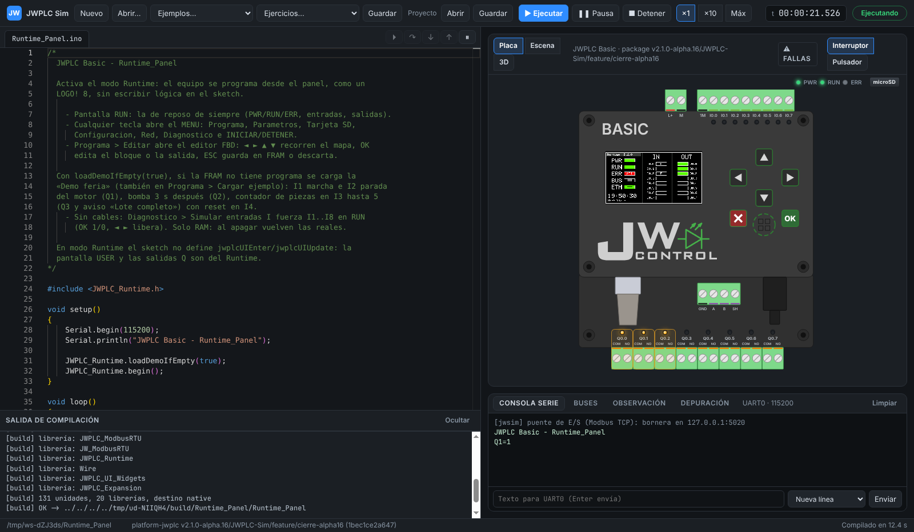
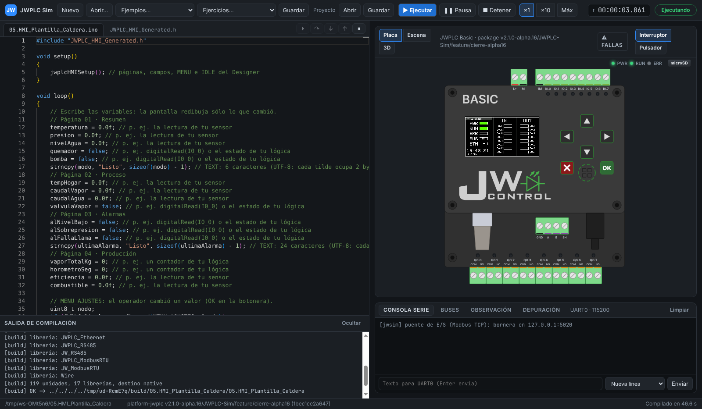

# JWPLC Sim

Simulador de escritorio del PLC **JWPLC Basic** de JW Control: el sketch y
las librerías del package JWPLC se compilan **desde su código fuente** para
el PC contra un HAL nativo del Arduino core ESP32, con un motor de tiempo
virtual determinista y modelos de periféricos a nivel de registros.

```text
Versión: 0.3.0 · package JWPLC 2.1.0-alpha.16 (package.lock)
Estado:  G0–G5 cerrados; G6 (OpenPLC): cadena real y recarga desde el editor PASS; botón «Simular» en el editor pendiente
Matriz:  138 ejemplos del package compilan, corren y pasan su prueba (SIM_REGRESSION en cada publicación)
```

## Descargar (Windows)

**[⬇ JWPLC Sim 0.3.0: instalador y portable](https://github.com/JW-Control/jwplc-sim/releases/latest)**. Traen el
package JWPLC, sus dependencias y el compilador GCC, así que no hace falta Node.js ni red. No tienen firma de
código: si Windows SmartScreen avisa, **Más información → Ejecutar de todas formas**.

Novedades de 0.3.0:

- Interfaz nueva: panel inferior a lo ancho (Problemas · Compilación · Serie · Tráfico · E/S y variables ·
  Depuración), que se oculta por completo (Ctrl+J); velocidad y puerto COM en la barra superior; la escena con
  pestañas laterales **Agregar** y **Propiedades**.
- **Puerto COM virtual** integrado en el instalador (com0com, par COM20 ↔ COM21): JW Serial u otro programa se
  conecta al USB o al RS-485 del PLC simulado.
- Serie a la velocidad real (115200 baudios): un `Serial.println` sin pausa ya no traba la PC; marca de tiempo
  por línea.
- E/S y variables con tabla de forzado (Forzar 0 · 1 · Liberar); ejercicios sin `pinMode` y que se ponen al día
  solos; la pestaña Tráfico muestra solo RS-485 y Modbus.
- Instalador: arreglado el aviso de procesos abiertos que impedía instalar o desinstalar.

Va junto a:

| Programa | Descarga |
|---|---|
| Package Arduino JWPLC 2.1.0-alpha.16 | [Release](https://github.com/JW-Control/platform-jwplc/releases/tag/v2.1.0-alpha.16) |
| OpenPLC Editor – JWPLC Edition 4.2.8-jwplc.9 y VPP | [Release](https://github.com/JW-Control/openplc-editor/releases/tag/jwplc-editor-v4.2.8-jwplc.9) |
| JWPLC HMI Designer 2.1.0-alpha.16 | adjunto a la [Release del package](https://github.com/JW-Control/platform-jwplc/releases/tag/v2.1.0-alpha.16) |

## Qué hace

- Compila el sketch con las librerías reales del package y lo corre en la PC con la placa en vivo: entradas,
  salidas, LED, pantalla TFT y botonera (clic o teclado).
- Abre proyectos de **OpenPLC Editor** con la cadena real del editor; guardar en el editor recarga la simulación.
- **Runtime de panel** (`JWPLC_Runtime`): programa estilo LOGO! desde la pantalla, con la «Demo feria» y
  Diagnóstico › Simular entradas I.
- **Pantalla en el navegador** (`JWPLC_WebScreen`) y una ventana para ver un JWPLC Basic real por Ethernet.
- Buses I2C/SPI/UART/Modbus, depuración con breakpoints, FRAM, NVS, RTC y microSD persistentes, varios PLC en
  RS-485, red virtual, fallas inyectadas y ejercicios con calificación automática.





Estado detallado de cada gate en [docs/GATES.md](docs/GATES.md).

## Abrir desde el código fuente

Requisitos: Node.js ≥ 22 y Git. En Linux, además, `gcc`/`g++` del sistema;
en Windows el compilador se descarga solo (WinLibs GCC 14.3.0, ~245 MB, con
su SHA-256 verificado, en `.jwsim/toolchain/`).

```sh
git clone https://github.com/JW-Control/jwplc-sim.git
cd jwplc-sim
node scripts/app.mjs
```

`scripts/app.mjs` descarga el package fijado y el toolchain (Windows) si
faltan, instala las dependencias de la app y la abre. Solo usa `node`: no
depende de cómo la terminal resuelve `npm` (ver abajo). `--setup` prepara
sin abrir.

En Windows, **`JWPLC Sim.bat`** (en la raíz) hace lo mismo con doble clic:
abre la app desde esta copia del repositorio, con los cambios locales.

**Ver > JWPLC real (pantalla en vivo)…** (`Ctrl+Shift+R`) abre en una ventana
aparte la pantalla de un JWPLC Basic real por Ethernet, con su botonera: el
sketch del equipo usa `JWPLC_WebScreen` (ejemplos de esa librería) y se escribe
su IP. Con un sketch que usa `JWPLC_WebScreen` corriendo en el simulador, la
misma ventana lo muestra en `127.0.0.1:1080`.

### Instalador y portable (Windows)

**`Generar instalador.bat`** (o `node scripts/dist.mjs`) arma en
`build\dist\`:

- `JWPLC-Sim-<versión>-instalador.exe`: instalador por usuario (en
  `%LOCALAPPDATA%\Programs`, sin pedir administrador), con accesos en el
  escritorio y el menú Inicio;
- `JWPLC-Sim-<versión>-portable.zip`: la misma app en una carpeta; se
  descomprime donde se quiera (también en un USB) y se abre `JWPLC Sim.exe`.
  Guarda sus datos en `datos\` dentro de la carpeta.

Los dos llevan el package fijado, las dependencias de terceros y el
toolchain GCC: compilan sin red ni Node.js en la PC. El workflow
*Instalador y portable (Windows)* (`.github/workflows/dist-windows.yml`) los
genera en GitHub Actions, a pedido y con cada tag `v*`; con un tag además los publica como Release.
`node scripts/dist.mjs --dir` arma solo la carpeta (en Linux, la versión de
Linux) para probar.

El ícono (un monitor con el frente del JWPLC Basic y el logo cuadrado de JW
Control) está en `app/icon/`: `icon.svg` es la fuente y
`node scripts/gen-icon.mjs` regenera los PNG y el `.ico` (16 a 256 px), que
se versionan. Lo usan el `.exe`, el instalador, los accesos directos y la
ventana de la app.

**Windows: "¿Cómo desea abrir este archivo?" al escribir `npm`.** Pasa
cuando la variable `PATHEXT` tiene una entrada vacía (un `;` de más, que
dejan algunos instaladores): PowerShell toma el archivo `npm` sin extensión
de la carpeta de Node (un script de bash) en lugar de `npm.cmd`.
`node scripts/app.mjs` lo evita y avisa si lo detecta. Para corregirlo en la
PC, ver qué tiene la variable con `$env:PATHEXT` y quitar el `;` sobrante en
*Configuración avanzada del sistema → Variables de entorno* (de usuario y de
sistema); luego abrir una terminal nueva. Mientras tanto, `npm.cmd install`
y `npm.cmd start` funcionan igual.

Con GCC propio en el `PATH` (MinGW-w64 ≥ 13 con hilos POSIX) también se
puede usar en Windows: el toolchain incluido tiene prioridad si está
descargado.

La primera compilación de un sketch tarda ~10–50 s (core + las librerías del
package que usa); un cambio posterior, menos de 1 s. Los ejemplos del package se
copian a `Documentos/JWPLC Sim/` antes de editarlos. F5 compila y ejecuta,
F6 pausa. Archivo → Abrir proyecto / Guardar proyecto (Ctrl+Mayús+O / S)
maneja archivos `.jwsim` (sketch, vínculos a OpenPLC y HMI, escena).

La ventana tiene arriba la barra (archivo, ejecución, velocidad ×1/×10/Máx,
tiempo virtual, estado y el puerto COM con su luz), en el centro el editor y
la placa, y abajo un panel a lo ancho, de alto ajustable y plegable, con las
pestañas **Problemas**, **Compilación**, **Serie**, **Tráfico**, **E/S y
variables**, **Depuración** y (con un ejercicio abierto) **Ejercicio**. Al
compilar el panel muestra Compilación; si hay errores, Problemas; al
ejecutar vuelve a Serie (o a la pestaña que se estaba mirando). Si edita el sketch con el Arduino IDE, la
simulación se recarga sola.

Depuración (G3), con el gdb del toolchain (o el del sistema en Linux):

- **Breakpoints**: clic en el margen del editor o F9. F8 continúa, F10 paso
  por encima, F11 entra, Mayús+F11 sale, Ctrl+F8 interrumpe. Detenido, el
  tiempo virtual no avanza; la pestaña Depuración muestra la pila y las
  variables.
- **E/S y variables**: tablas de entradas y salidas con su valor, su estado
  (Libre / Forzada) y los botones Forzar 0 · 1 · Liberar, como la tabla de
  forzado de un PLC (marca "F" en la placa); al lado, variables del sketch
  en vivo.
- **Grabación**: toda la sesión (entradas y forzados) se guarda como `.stim`
  con su hash; Simulación → Reproducir grabación la repite y compara el hash.
- **Tráfico**: RS-485 y Modbus RTU/TCP (en modo avanzado también I2C por registro, SPI por CS (TFT, SD, FRAM, W5500), UART y
  Modbus RTU/TCP con CRC), con filtro por tipo.

Periféricos (G4), modelados por registros contra sus hojas de datos:

- **Pantalla y botonera**: la TFT ST7789 se ve en la placa en vivo; la
  botonera responde al clic o, con foco en la pantalla, a las flechas, Enter
  (OK) y Esc.
- **Memoria no volátil**: FRAM, NVS (`Preferences`, `EEPROM`), RTC con
  batería y tarjeta microSD se guardan por proyecto (carpeta
  `<proyecto>.estado`). El RTC arranca con la hora de la PC.
- **microSD**: tarjeta SDHC de 64 MiB formateada FAT32; `SD`, `JW_SD`,
  `JWPLCDataLog` y `fopen("/sd/…")` funcionan como en la placa. El zócalo de
  la placa quita y pone la tarjeta. Para usar una imagen propia, copie un
  `.img` como `sd.img` en la carpeta de estado.
- **Serie**: el monitor del USB (UART0). «Marca de tiempo» antepone a cada
  línea el tiempo virtual en que el PLC la empezó a enviar
  (`00:00:01.250 > …`). El campo de abajo envía texto por UART0 (con el fin
  de línea elegido); queda en la grabación.
- **Temporizadores y reinicio**: `esp_timer`, `Ticker`, timers de FreeRTOS,
  `timerBegin` y `ESP.restart()` (el PLC reinicia conservando FRAM, NVS, SD,
  RTC, salidas del expansor y pantalla).
- **RS-485**: varios PLC simulados en un mismo bus Modbus RTU, y una
  herramienta externa (JW Modbus Tool) conectada al bus por un socket TCP o
  un puerto COM virtual: `node cli/jwsim-bus.mjs`.
- **Ethernet (W5500)**: la placa lo trae poblado. En la app (o con
  `node cli/jwsim-net.mjs <sketch>`) el PLC está en una red virtual con
  DHCP cuya puerta de enlace es el PC; sus puertos de escucha se publican en
  el PC (Modbus TCP 502 → 127.0.0.1:1502) y sus conexiones salen por la red
  del PC. `"ethernet": { "present": false }` en `simulation.peripherals`
  del proyecto lo quita.
- **Fallas** (G9): con la simulación en marcha se inyectan desde la escena
  (sensor o pulsador pegado, contactor soldado, bobina o lámpara quemada,
  cable cortado) y desde el menú «Fallas» de la placa (RTC sin batería,
  ruido en RS-485); la microSD se quita con un clic en su zócalo.
- **Ejercicios** (G9): el menú «Ejercicios…» abre ocho ejercicios con la
  escena cableada y el enunciado; **Calificar** corre el programa en cada
  caso de la rúbrica y da la nota de 0 a 20 con el detalle
  ([docs/EJERCICIOS.md](docs/EJERCICIOS.md)).

Pruebas E2E de la interfaz: `cd app && npm run test:e2e` (G2),
`npm run test:e2e:g3` (G3) y `npm run test:e2e:g4` (G4) (en Linux sin
pantalla, `xvfb-run -a npm run test:e2e`).

## Documentación

- [Arquitectura](docs/ARCHITECTURE.md): capas, qué se reemplaza del core,
  formato `.jwsim`, interfaz de dispositivos, protocolo, modelo de tiempo,
  límites de fidelidad, sincronización con el package y hallazgos.
- [Gates](docs/GATES.md): G0 a G10 con criterios medibles.
- [Licencias](docs/LICENSES.md): matriz de dependencias y recomendación.
- [CLI](docs/CLI.md): `jwsim-cli` sin interfaz (JSON, códigos de salida,
  pruebas `*.jwtest.json`, paridad con el package, matriz de ejemplos).
- Informes: [G0](docs/reports/G0_POC_IO_BASIC.md), [G1](docs/reports/G1.md), [G2](docs/reports/G2.md), [G3](docs/reports/G3.md), [G4](docs/reports/G4.md), [G5](docs/reports/G5.md), [G7](docs/reports/G7.md), [sincronización con alpha.13](docs/reports/SYNC_ALPHA13.md).
- [Ejercicios](docs/EJERCICIOS.md): los ocho ejercicios, la rúbrica y la
  calificación automática.
- [SDK de dispositivos](docs/SDK.md): dispositivos de escena en TypeScript,
  nativos en C, plantillas e índice comunitario firmado.

## Prueba rápida (headless)

Requisitos: Node.js ≥ 20, git y GCC: `gcc`/`g++` en Linux, MinGW-w64 GCC
en Windows (o `x86_64-w64-mingw32-g++-posix` para compilar desde Linux con
`--target windows`; se ejecuta con wine). `--target linux-x86` (`gcc -m32`,
paquete `g++-multilib`) reproduce el modelo de datos ILP32 del ESP32.

```sh
node scripts/fetch-package.mjs        # descarga el tag fijado a .jwsim/ (no se versiona)
node cli/jwsim-cli.mjs run \
  tests/sketches/g8_biestable \
  -- --until 3000 --set I0_0=1@1000 --set I0_0=0@2000
node scripts/gate-g0-poc.mjs          # gate JWSIM_G0_POC_IO_BASIC
node cli/jwsim-cli.mjs test tests/examples/JWPLC_Display   # pruebas de los ejemplos de una librería
node cli/jwsim-cli.mjs matrix         # todos los ejemplos del package × (compila, corre, pasa su prueba)
node cli/jwsim-cli.mjs parity v2.1.0-alpha.16              # qué cambia un tag nuevo del package
```

Opciones del runner: `--until <ms>`, `--set SEÑAL=V@ms`, `--stim archivo`,
`--realtime <factor>`, `--seed <n>`, `--stats`, `--quiet`, `--state <dir>`
(FRAM, NVS, RTC y microSD persistentes), `--rtc host|fijo:AAAA-MM-DDTHH:MM:SS`,
`--no-eth` (placa sin el W5500).
Depuración: `JWSIM_TRACE_TASK=<tarea> JWSIM_TRACE_BT=1` imprime dónde se
bloquea una tarea; `JWSIM_EXTRA_FLAGS=-fsanitize=address` compila con ASan.

## Reglas del repositorio

- El package JWPLC **no se copia ni se parchea** aquí: se descarga del tag
  fijado en `package.lock`. Lo que impida simular se documenta como punto de
  extensión para una alpha futura.
- Documentación en español.
- Commits sin líneas de coautor (`Co-Authored-By`).

## Licencias

- Código: [GPL-3.0-or-later](LICENSE).
- Interfaz del SDK de dispositivos: [MIT](LICENSES/MIT.txt).
- Documentación y materiales: [CC BY-SA 4.0](LICENSES/CC-BY-SA-4.0.txt).

Detalle por ruta en `REUSE.toml` y en [docs/LICENSES.md](docs/LICENSES.md).
