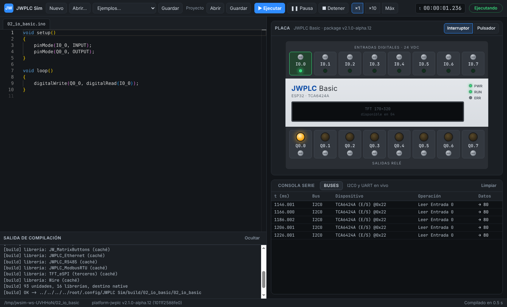

# Informe G2 — Editor integrado

```text
Package: platform-jwplc v2.1.0-alpha.12 (1011f2588fe0), sin modificaciones
App: Electron 44.6.0 · Monaco 0.57.0 · Playwright 1.63.0 (solo pruebas)
Host de referencia: GitHub Actions windows-latest (x64), workflow g2-windows.yml
  corrida 2: https://github.com/JW-Control/jwplc-sim/actions/runs/39718709269
Además: Linux x86_64 (Xvfb) y la PC Windows 11 de JW Control

JWSIM_G2_SPLIT_UI=PASS               arranque en frío 2,6 s en CI (0,67 s en la PC de JW Control)
JWSIM_G2_LOCAL_COMPILE=PASS          gate 1,16–1,26 s; dentro de la app, guardar + compilar + arrancar 2,0 s
JWSIM_G2_ERROR_MAPPING=PASS          5 errores en 2 pestañas, archivo:línea y marcas en el editor
JWSIM_G2_UNSUPPORTED_LIB_MSG=PASS    10 familias, mensaje con API y gate (o "no está en el plan")
JWSIM_G2_PROJECT_LINKING=PASS        esquema jwsim-1, migración v0 → v1, vínculos y campos desconocidos
JWSIM_G2_EXTERNAL_EDIT_RELOAD=PASS   recarga en 1,86 s en CI, con la escena conservada (margen estrecho)
```

Los criterios con tiempo de pared se miden en el host de CI de referencia
(convenciones de [GATES](../GATES.md)): el workflow
[`g2-windows.yml`](../../.github/workflows/g2-windows.yml) corre, a pedido,
los gates y la E2E en `windows-latest` y publica `build/gates` como
artefacto.



## 1. Reproducir

```sh
node scripts/gate-g2-local-compile.mjs [--target windows]
node scripts/gate-g2-unsupported.mjs [--target windows]
node --test tests/build/prototypes_test.mjs tests/build/project_test.mjs
cd app && npm run test:e2e        # Linux sin pantalla: xvfb-run -a npm run test:e2e
```

Informes en `build/gates/JWSIM_G2_*.json` y capturas en `build/gates/g2/`.

## 2. `JWSIM_G2_SPLIT_UI`

| Criterio | Resultado |
|---|---|
| Código y simulación lado a lado | Monaco a la izquierda; placa, consola y Buses a la derecha |
| Pestañas Sketch, Placa, Consola, Buses | Pestañas por archivo del sketch; placa siempre visible; Consola serie y Buses en el panel inferior |
| Buses en vivo | Transacciones I2C0 decodificadas (`TCA6424A (E/S) @0x22 · Leer Entrada 0 → 80`) y bytes de UART; solo se transmiten con la pestaña abierta |
| Arranque en frío < 5 s | **Windows (CI): 2,6 s**; PC Windows 11 de JW Control: 0,67–0,69 s. Linux: 0,8–1,15 s, con dos valores atípicos (17 s y 27 s) en el contenedor de pruebas tras mucha actividad de disco, que no aparecieron en Windows |

## 3. `JWSIM_G2_LOCAL_COMPILE`

| Criterio | Linux | Destino Windows (wine) |
|---|---|---|
| C1 sin red (sketch nuevo, `unshare -n`) | OK, 9,0 s (primera compilación) | OK, 9,3 s (compilación cruzada) |
| C2 cambio en `loop()` → recompilación | **0,41 s** (antes ~10 s) | **0,70 s** |
| C3 prototipos automáticos | `g2_prototipos`: funciones usadas antes de definirse y desde otra pestaña | OK (`.exe` bajo wine) |
| C4 toolchain | `g++` del sistema | MinGW-w64 GCC 13 (cruzado) |
| Dentro de la app: guardar + compilar + arrancar | 0,95 s (`Compilado en 0,5 s`) | — |

Qué bajó la recompilación de ~10 s a ~0,4 s (ARCHITECTURE §3.1): caché del
descubrimiento de librerías, header precompilado del prefijo del `.ino`
(compartido entre sketches), y no reescribir el `.ino.cpp` ni los `.a`
cuando no cambian. La matriz de 131 sketches y el determinismo de G1 se
repitieron con estos cambios: mismo resultado (109 compilan, 0 fallas
inesperadas) y mismos hashes.

**Toolchain incluido.** `scripts/fetch-toolchain.mjs` instala el GCC fijado
en `third_party/toolchain.json` en `.jwsim/toolchain/`, y el build lo usa
antes que el del `PATH`. Versión fijada: WinLibs GCC 14.3.0, UCRT, hilos
POSIX, mingw-w64 12.0.0 r1 (243,7 MB,
SHA-256 `d6e83bf3cfff02ddcb4ccb485a8a162e3852bf09976d0cb9d521f3d0d6855ea3`).
Probado bajo wine: compila, precompila headers, enlaza estático con
`std::thread` y el `.exe` corre.

## 4. `JWSIM_G2_ERROR_MAPPING`

`tests/sketches/g2_errores`: 3 errores en la pestaña principal (líneas 5,
11 y 16) y 2 en `extra.ino` (4 y 8). La app lista exactamente esos 5, con
archivo, línea y columna, y los marca en el editor de cada pestaña. Un clic
lleva a la línea. `ayudante()`, definida en `extra.ino` y llamada desde la
principal, no genera un sexto error gracias a los prototipos automáticos.

## 5. `JWSIM_G2_UNSUPPORTED_LIB_MSG`

Un sketch por familia en `tests/sketches/g2_unsupported`:

| Familia | Cuándo | Mensaje (resumen) |
|---|---|---|
| Wi-Fi/BLE (`WiFi.h`) | compilación | radio no simulada; no está en el plan; use JWPLC_Ethernet (JWSIM_G4_W5500_MODEL) o RS-485 (JWSIM_G4_RS485_MULTINODE) |
| Pila lwIP (`WebServer.h`) | compilación | no está en el plan; use JWPLC_Ethernet |
| NVS (`Preferences.h`) | compilación | llega en JWSIM_G4_NVS_PREFERENCES; mientras tanto JW_FRAM |
| Flash FS (`LittleFS.h`) | compilación | no está en el plan; use la microSD (JWSIM_G4_SD_DATALOG) |
| ADC (`analogRead`), DAC (`dacWrite`) | primer uso | no está en el plan |
| I2C esclavo (`Wire1.begin(addr)`) | primer uso | no está en el plan |
| `xTimerCreate`, `esp_timer_create`, `esp_restart` | primer uso | llegan en JWSIM_G4_HAL_EXTRAS (gate nuevo) |

`analogWrite` ya no figura: está soportado desde G1 (LEDC). En el JWPLC Basic
`Wire` (I2C0) ya es maestro del TCA6424A desde el arranque del core, así que
`Wire.begin(addr)` devuelve `false` sin llegar al HAL, igual que en la placa;
la prueba de esclavo usa `Wire1`.

## 6. `JWSIM_G2_PROJECT_LINKING` y `JWSIM_G2_EXTERNAL_EDIT_RELOAD`

**Proyecto.** [`schema/jwsim-1.json`](../../schema/jwsim-1.json) (MIT),
validado al abrir y al guardar; los errores llegan con su ruta
(`/links/hmi: no cumple el formato…`). El validador sin dependencias se
contrastó con Ajv 8 sobre los mismos casos. Tests: v1 válido, migración de
un borrador v0, errores con ruta, versión futura rechazada, y guardar
conservando campos desconocidos con rutas relativas. En la app, Proyecto →
Abrir/Guardar: abre el sketch vinculado, muestra OpenPLC y HMI en la barra
de estado (o "no encontrado"), y aplica la escena (modo de entradas, nivel
inicial, velocidad).

**Recarga externa.** La app vigila la carpeta del sketch. Cuando otro editor
lo cambia y no hay cambios sin guardar en la app, recarga el editor,
recompila y reinicia la simulación con las mismas entradas activas. Si hay
cambios sin guardar, conserva los de la app y avisa. Medido en la E2E:
escritura externa → simulación nueva corriendo en 0,44–0,56 s, con I0.0
conservada y la lógica nueva visible en Q0.0.

## 7. Windows: lo que hubo que resolver

Las corridas en Windows (la PC de JW Control y luego GitHub Actions)
destaparon problemas que wine no reproduce:

| Problema | Efecto | Solución |
|---|---|---|
| URL de WinLibs inexistente | 404 al instalar el toolchain | Versión fijada que existe: GCC 14.3.0 UCRT r1, con SHA-256 |
| `npm` en PowerShell abría un diálogo "¿cómo abrir?" | `npm install` no instalaba nada | Usar `npm.cmd` (a esa PC le falta `.CMD` en `PATHEXT`) |
| Lector de `.d` cortaba en el `:` de `C:` | Cada build recompilaba las 93 unidades (32,8 s) | Objetivo termina en `:` seguido de espacio, con tests |
| Fechas de modificación consultadas una vez por unidad y header | Revisión de dependencias lenta en Windows | Caché por build |
| Detección de "falla de PCH" demasiado amplia | El PCH quedaba desactivado para siempre | Solo mensajes reales de GCC, y solo si sin PCH compila |
| `cc1plus.exe` de WinLibs con ASLR | `PCH allocation failure` aleatorio; recarga de 9,7 s | Se quitan `DYNAMIC_BASE` y `HIGH_ENTROPY_VA` del encabezado PE; reintento como red de seguridad |
| `nm`/`objcopy` sobre ~700 objetos en cada build | ~0,27 s por build | Caché por objeto (24–41 ms) |
| Electron descarga su binario al pedir su ruta | Arranque medido de 5,3 s en la primera corrida de CI | La E2E lo descarga antes de medir |

Tiempos por fase de la recarga en CI: `gcc` del `.ino` con PCH 1,32 s,
enlace 0,36 s, weak PE/COFF 0,04 s. El margen frente a los 2 s es estrecho:
si un cambio futuro lo rompe, el siguiente paso es reducir el PCH (el
autoload de `Arduino.h` arrastra 16 librerías) o enlazar el sketch aparte.
