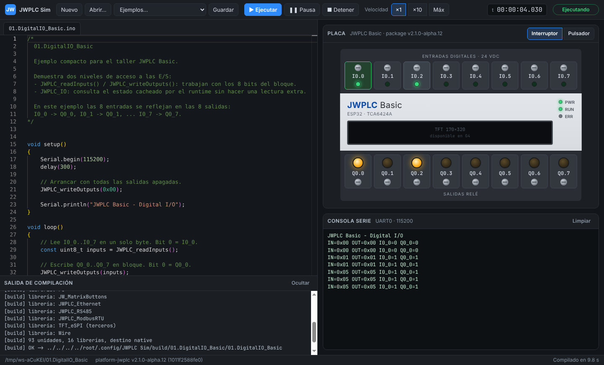

# Informe G2 — MVP de la interfaz

```text
Package: platform-jwplc v2.1.0-alpha.12 (1011f2588fe0), sin modificaciones
App: Electron 44.6.0 · Monaco 0.57.0 · Playwright 1.63.0 (solo pruebas)
Host de prueba: Linux x86_64 con Xvfb (la ventana en Windows se verifica en la PC del usuario)
Prueba E2E: node app/tests/e2e-g2.mjs (xvfb-run -a en Linux sin pantalla) → G2 MVP E2E=PASS
```



## Qué incluye

| Área | Estado |
|---|---|
| Editor | Monaco con pestañas de los archivos del sketch (`.ino`, `.h`, `.cpp`), indicador de cambios sin guardar, Ctrl+S |
| Sketches | Nuevo, Abrir, Ejemplos del package (se copian a `Documentos/JWPLC Sim/`; el package fijado nunca se edita) |
| Ejecutar (F5) | Guarda, compila con `jwsim-cli` y lanza el runner en `--port stdio` |
| Tiempo | Pausa/continuar (F6), velocidad ×1, ×10 y máxima, reloj virtual |
| Placa | 8 entradas `I0.0..I0.7` en modo interruptor o pulsador, 8 salidas a relé `Q0.0..Q0.7`, LEDs PWR/RUN/ERR |
| Consola | UART0 en vivo |
| Errores | Diagnósticos de GCC en el panel y como marcas en la línea del `.ino`; clic lleva a la línea |

## Mediciones

| Criterio | Resultado |
|---|---|
| Arranque en frío hasta el editor con el sketch cargado | 1,0 s (criterio `G2_SPLIT_UI`: < 5 s) |
| `02_io_basic`: I0.0 → Q0.0 en la placa, sin otras salidas | OK |
| Error sembrado en la línea 4 de un sketch nuevo | Panel `sketch_….ino:4:11 expected primary-expression…` y marca en la línea 4 |
| Recompilación tras cambiar `loop()` | 1,96 s en Linux (criterio `G2_LOCAL_COMPILE`: < 3 s); la primera compilación de un sketch, ~10 s |

La caché del descubrimiento de librerías (`discovery.json`, clave = directivas
del preprocesador del sketch + commit del package + manifiesto + flags) es
la que baja la recompilación de ~10 s a ~2 s.

## Falta para cerrar G2

- Pestaña Buses (con el analizador de G3) y prueba E2E del arranque en Windows.
- Prototipos automáticos de funciones (como arduino-cli/ctags).
- Prueba de 5 errores en 2 pestañas.
- Mensaje de API no soportada que nombre el gate que la soportará.
- Proyecto `.jwsim` v1 (vínculo con OpenPLC y `.hmi`) y recarga al editar
  desde el Arduino IDE.
- Instalador con el toolchain incluido (hoy se requiere GCC en el `PATH`).
