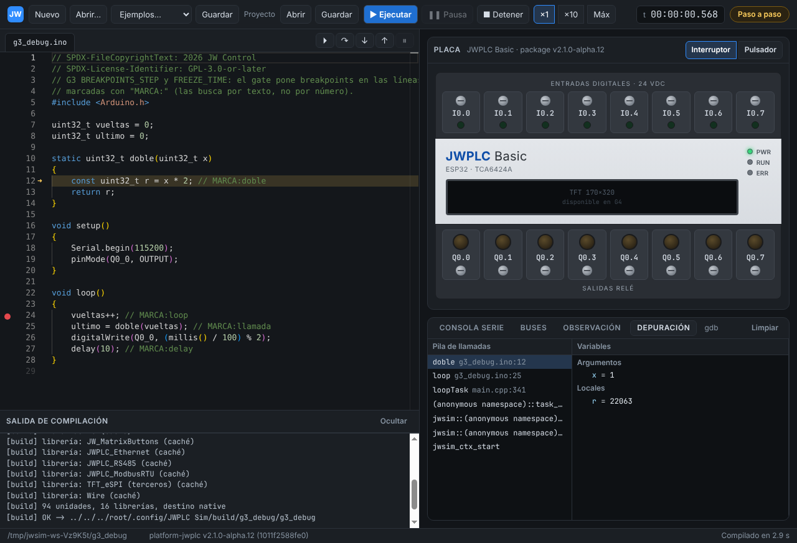
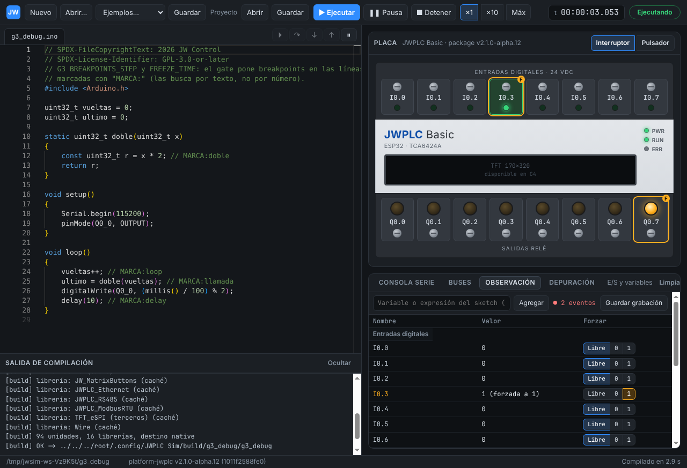
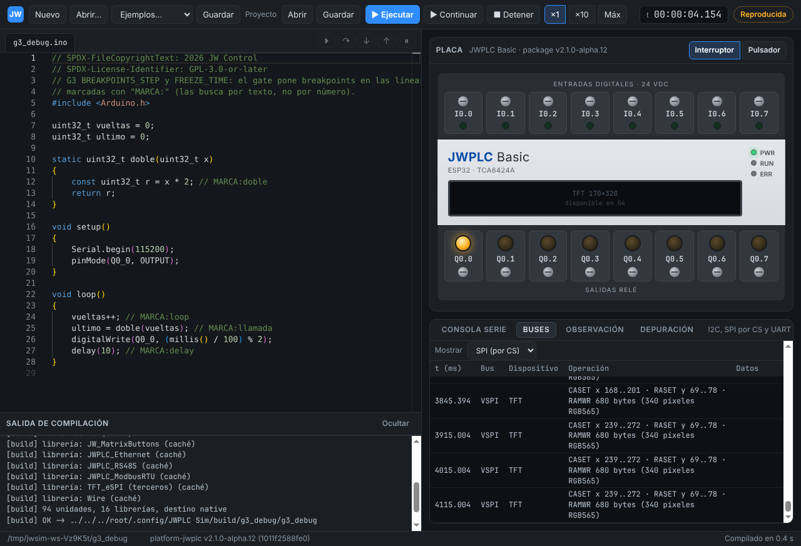

# Informe G3 — Depuración

```text
Package: platform-jwplc v2.1.0-alpha.12 (1011f2588fe0), sin modificaciones
Depurador: gdb -i=dap (Debug Adapter Protocol nativo de GDB)
  Windows: gdb 16.3 del toolchain incluido (WinLibs) · Linux: gdb 15.1 del sistema
Host de referencia: GitHub Actions windows-latest (x64), workflow g3-windows.yml
  @@CORRIDA@@
Además: Linux x86_64 (Xvfb)

JWSIM_G3_BREAKPOINTS_STEP=PASS   breakpoint, next, stepIn, stepOut y variables en el .ino (gate y E2E)
JWSIM_G3_FREEZE_TIME=PASS        detenido 10 s: millis() y tiempo virtual idénticos, sin recuperar el tiempo al continuar
JWSIM_G3_WATCH_FORCE_IO=PASS     variables en vivo, forzado de I0/Q0 con marca en placa y tabla, queda en la grabación
JWSIM_G3_BUS_ANALYZER=PASS       11 capturas de referencia (7 del firmware real, idénticas en Linux y Windows)
JWSIM_G3_RECORD_REPLAY=PASS      sesiones a máx. y ×10 reproducidas con el mismo hash (CLI, protocolo y app)
```



## 1. Reproducir

```sh
node scripts/gate-g3-debug.mjs           # BREAKPOINTS_STEP y FREEZE_TIME
node scripts/gate-g3-record-replay.mjs   # RECORD_REPLAY
node scripts/gate-g3-bus-analyzer.mjs    # BUS_ANALYZER (--show imprime las filas)
cd app && npm run test:e2e:g3            # E2E (Linux sin pantalla: xvfb-run -a ...)
node scripts/diag-gdb-attach.mjs         # diagnóstico del attach (gdb -batch y DAP)
```

Informes en `build/gates/JWSIM_G3_*.json` y capturas en `build/gates/g3/`.
El workflow [`g3-windows.yml`](../../.github/workflows/g3-windows.yml) corre
todo en `windows-latest` (con `JWSIM_DAP_TRACE=1`, la traza de eventos de
gdb) y publica `build/gates` como artefacto.

## 2. Depurador

Diseño en [ARCHITECTURE §7.1](../ARCHITECTURE.md). Sketch de referencia:
[`tests/sketches/g3_debug`](../../tests/sketches/g3_debug/g3_debug.ino)
(el gate ubica las líneas por las marcas `MARCA:`).

| Criterio | Resultado |
|---|---|
| Breakpoint en `loop()` (línea 24) | verificado por gdb, detiene con `reason=breakpoint` |
| Paso por encima | línea 25 |
| Entrar a `doble()` | línea 12, pila `doble ← loop ← loopTask`; argumento `x = 1` |
| Salir | vuelve a `loop()` línea 25; `ultimo == 2 × vueltas` |
| Observación en vivo | `vueltas` crece entre dos muestras; `ultimo == 2 × vueltas` |
| Congelado 10 s | `jwsim_now()`, `millis` y `vueltas` idénticos; el runner no envía nada |
| Al continuar | avance virtual ≈ avance de pared (sin "recuperar" 10 s) |
| Sin perturbación | misma corrida sin depurador hasta el mismo instante → mismo hash |

Hallazgos de la integración (resueltos):

- **gdb 16 difiere la respuesta a `attach`** hasta `configurationDone` (gdb
  15 responde enseguida). Esperarla antes de configurar trababa el arranque
  en Windows: ahora se sigue el orden del protocolo y se espera al final.
- **La pausa en Windows** (`interrupt` → `DebugBreakProcess`) llega en un hilo
  inyectado y con `reason` `stopped` o `signal`, no `pause`: la sesión la
  reconoce como pausa pedida y sigue mirando el hilo principal del firmware.
  Un SIGTRAP sin breakpoint posterior se continúa solo.
- **gdb 16 agrega un ámbito con todas las globales** del programa (pines,
  constantes de las librerías): la interfaz lo muestra plegado.
- **Linux con Yama** (`ptrace_scope = 1`): el runner autoriza el ptrace con
  `PR_SET_PTRACER` cuando lo lanza la app (`JWSIM_DEBUG=1`).
- La compilación de la app pasó a un *worker thread*: sus tramos síncronos
  (nm, objcopy) congelaban la ventana en una compilación en frío en Windows.

## 3. Observación, forzado y grabación



La E2E agrega `vueltas` a la tabla (se lee en vivo con pausas de
microsegundos: el tiempo virtual no avanza), fuerza `Q0_7 = 1` (salida que
el sketch no maneja) e `I0_3 = 1`, verifica la marca "F" en la placa y en la
tabla, libera `Q0_7` y luego guarda la sesión. El `.stim` contiene
`force Q0_7=1`, `unforce I0_3`, etc.; reproducirlo en la app llega al mismo
instante con el mismo hash.

`gate-g3-record-replay` hace lo mismo sin interfaz con un guion de entradas,
forzados y pausas enviado en instantes de pared arbitrarios, a máxima
velocidad y a ×10, y verifica la reproducción por la CLI (`--stim --until`)
y por el protocolo (`run` con `until_ns`).

## 4. Analizador de buses



Capturas de referencia en [`tests/bus/`](../../tests/bus): cada una trae los
ítems crudos y la decodificación esperada (campos), escrita a mano a partir
de los datasheets y del código de los ejemplos.

| Captura | Fuente | Qué verifica |
|---|---|---|
| `i2c-tca6424a` | `02_io_basic` del package | sondeo del RTC (NACK), configuración y lectura del TCA6424A por registro |
| `i2c-referencia` | sintética | hora del DS3232M en BCD, autoincremento, NACK de datos y de dirección |
| `spi-tft` | `02_io_basic` (core) | ST7789: CASET/RASET/RAMWR (108 800 bytes), SLPOUT, MADCTL ← 08, COLMOD ← 55… |
| `spi-fram` | `JW_FRAM/Basic_RW` | WREN, WRITE 0x0000 ← 64 00 00 00 (`int32_t 100`), 0x0008 ← `1.2345f`, WRDI, READ |
| `spi-w5500` | core (Ethernet) | registros comunes y sondeos de chip del driver fuera del formato W5500 |
| `spi-sd-referencia` | sintética | CMD0/8/55/ACMD41/58/17 con CRC7 y R1, token de datos |
| `modbus-rtu-maestro-lectura` | `02.ModbusRTU_Master_Read` | FC03 al esclavo 2, inicio 0, cantidad 4, CRC 0x3A44 |
| `modbus-rtu-maestro-escritura` | `03.ModbusRTU_Master_Write` | FC06 registro 1 ← 1, CRC válido |
| `modbus-rtu-referencia` | sintética | ejemplos de la especificación: FC03/06/16/01, excepción, CRC incorrecto, dos tramas en un bloque |
| `modbus-tcp-referencia` | sintética | MBAP + PDU dentro de los buffers del socket 0 del W5500 |
| `uart-consola` | `02.ModbusRTU_Master_Read` | texto de UART0 |

Las capturas del firmware se vuelven a tomar en cada corrida y deben ser
**idénticas** a las guardadas, en Linux y en Windows; observar los buses no
cambia el hash de traza. Las sintéticas cubren lo que el firmware todavía no
puede producir en G3: respuestas Modbus (falta un esclavo: bus RS-485
multinodo en G4), Modbus TCP (modelo W5500 en G4) y la tarjeta SD (G4). Los
CRC se validaron contra vectores publicados (Modbus `01 03 00 00 00 0A C5 CD`,
`11 03 00 6B 00 03 76 87`…; SD CMD0 `0x95`, CMD8 `0x87`, ACMD41 `0x77`…).

## 5. Pendiente para G4

- Recepción de UART desde el exterior (RS-485 multinodo, inyección desde la
  interfaz) con su registro en la grabación.
- Modelos SPI (FRAM, SD, W5500, ST7789): el analizador ya decodifica lo que
  el firmware envía; hoy MISO responde 0xFF.
