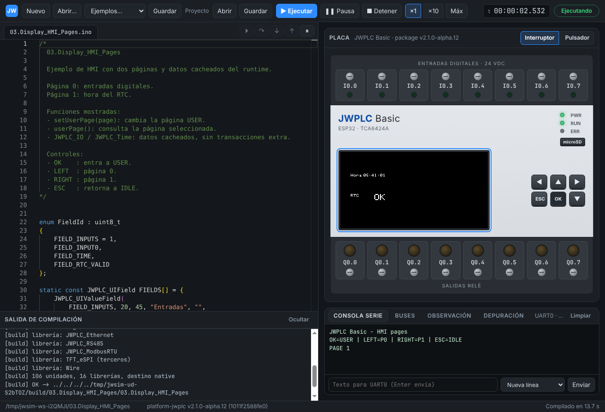

# Informe G4 — Periféricos

```text
Package: platform-jwplc v2.1.0-alpha.12 (1011f2588fe0), sin modificaciones
Host de referencia: GitHub Actions windows-latest (x64), workflow g4-windows.yml
  corrida 2: https://github.com/JW-Control/jwplc-sim/actions/runs/39768522893 (todo PASS, E2E incluida)
Además: Linux x86_64 y Windows bajo wine (mismos hashes en los tres)

JWSIM_G4_RTC_DS3232M=PASS        modelo por registros (hora, 12/24 h, alarmas, OSF, temperatura, SRAM); 03.RTC_Basic
JWSIM_G4_NVS_PREFERENCES=PASS    NVS de ESP-IDF v5 en el HAL; Preferences, EEPROM y los 10 ejemplos de JWPLC_LogicRuntime
JWSIM_G4_HAL_EXTRAS=PASS         esp_timer, timers de FreeRTOS, timers de hardware y esp_restart() con estado tibio
JWSIM_G4_FRAM_PERSIST=PASS       MB85RS64V persistente; 04.FRAM_Basic cuenta arranques
JWSIM_G4_SD_DATALOG=PASS         microSD SDHC sobre imagen FAT32; FatFs y VFS reales; JWPLCDataLog con extracción
JWSIM_G4_TFT_HMI=PASS            ST7789 en la app; HMI de JWPLC_Display con la botonera; capturas idénticas
JWSIM_G4_RS485_MULTINODE=PASS    UART con tiempo de carácter; bus de 3 nodos, choques y herramienta externa (TCP o COM)
JWSIM_G4_W5500_MODEL=PASS        W5500 por registros (8 sockets, INTn, PHY) y red del host: DHCP, IP fija, cable, cliente TCP, reproducción
JWSIM_G4_MODBUS_TCP_HOST=PASS    01.ModbusTCP_Server desde el host, dos PLC en 1502/2502, 02.ModbusTCP_Client contra un servidor del host

W5500_MODEL y MODBUS_TCP_HOST pasan también con v2.1.0-alpha.13 (publicado el
2026-10-22), sin cambios en el simulador; el package fijado sigue en alpha.12.
```



## 1. Reproducir

```sh
node scripts/test-models.mjs              # tests de los modelos (sin firmware)
node scripts/gate-g4-rtc.mjs              # RTC_DS3232M
node scripts/gate-g4-fram.mjs             # FRAM_PERSIST
node scripts/gate-g4-nvs.mjs              # NVS_PREFERENCES
node scripts/gate-g4-hal-extras.mjs       # HAL_EXTRAS
node scripts/gate-g4-sd.mjs               # SD_DATALOG
node scripts/gate-g4-tft.mjs              # TFT_HMI
node scripts/gate-g4-rs485.mjs            # RS485_MULTINODE
node scripts/gate-g4-w5500.mjs            # W5500_MODEL (red del host: 127.0.0.1)
node scripts/gate-g4-modbus-tcp.mjs       # MODBUS_TCP_HOST (puertos 1502, 2502)
cd app && npm run test:e2e:g4             # E2E (Linux sin pantalla: xvfb-run -a ...)
```

Con `--target windows` cada gate compila con MinGW y ejecuta con wine
(en Windows, directamente). Informes en `build/gates/JWSIM_G4_*.json` y
capturas en `build/gates/g4/`. El diseño está en
[ARCHITECTURE §7.2, §7.3 y §7.4](../ARCHITECTURE.md).

## 2. Modelos

Cada modelo se escribió contra su hoja de datos y trae un `MODEL.md` con una
fila por comportamiento; cada fila tiene su test en `tests/models/` (sin
firmware).

| Modelo | Tests | Ejemplos del package que pasan |
|---|---|---|
| [DS3232M](../../sim/models/ds3232m/MODEL.md) | 10 | `03.RTC_Basic` |
| [MB85RS64V](../../sim/models/mb85rs64v/MODEL.md) | 6 | `04.FRAM_Basic`, `JW_FRAM/Basic_RW` |
| [ST7789](../../sim/models/st7789/MODEL.md) | 9 | `03.Display_HMI_Pages`, todo sketch (el runtime dibuja la pantalla de reposo) |
| [microSD](../../sim/models/sdcard/MODEL.md) | 16 | `05.microSD_Basic`, `JW_SD/CardInfo`, `JW_SD/BasicReadWrite`, `SD/SD_Test` |
| [W5500](../../sim/models/w5500/MODEL.md) | 17 | `01.Ethernet_DHCP_Basic`, `02.Ethernet_StaticIP_Basic`, `01.ModbusTCP_Server`, `02.ModbusTCP_Client` |

## 3. Estado no volátil

`--state <dir>` (en la app, uno por sketch) guarda FRAM, NVS, RTC y la
tarjeta. Los gates verifican la persistencia arrancando varias veces sobre
el mismo directorio:

- **FRAM**: `04.FRAM_Basic` cuenta 1, 2, 3 arranques; con el mismo estado de
  partida el hash es el mismo.
- **RTC**: sin batería (estado nuevo) el RTC no tiene hora y el ejemplo lo
  informa; con `--rtc fijo:` la hora sigue al tiempo virtual (también a
  máxima velocidad: 60 s virtuales = 60 s del RTC); la batería conserva la
  hora entre corridas; `--rtc host` toma la de la PC.
- **NVS**: la API de `Preferences` (33 comprobaciones en el primer arranque y
  14 en el segundo), `StartCounter` 1, 2, 3, `Prefs2Struct`, `EEPROM` (4
  ejemplos) y los 10 ejemplos de `JWPLC_LogicRuntime` que antes se
  rechazaban por usar `Preferences`. `Superblock_Redundancy` informa "1 FAIL"
  en cualquier destino: es el hallazgo H13 del package.
- **microSD**: `05.microSD_Basic` agrega una línea por arranque a
  `/taller.txt`; cada imagen resultante se lee con un lector FAT32 propio
  (`scripts/lib/fat.mjs`, independiente de FatFs) que verifica contenido,
  fechas y consistencia (cadenas de clústeres, FAT1 = FAT2, FSInfo).

## 4. microSD y archivos

| Criterio | Resultado |
|---|---|
| Ejemplos | `CardInfo`: tipo SDHC, 64 MB; `SD_Test`: 1 MiB escrito en 1566 ms virtuales; fsck limpio |
| VFS de ESP-IDF | `tests/sketches/g4_sd_vfs`: 26 comprobaciones de `fopen/fseek/stat/opendir/rename/unlink` sobre `/sd`, y rutas fuera de los montajes → ENOENT (el firmware no ve el disco de la PC) |
| JWPLCDataLog | una línea cada 100 ms con la hora del RTC (`--rtc fijo:2026-10-22T08:30:00`); se quita la tarjeta 0,8 s y se vuelve a poner: 51 líneas aceptadas = 51 en el archivo, fecha del archivo 2026-10-22 08:30:04 |
| Detección | sin tarjeta (`SD_CARD=0`, GPIO39 en alto) el runtime informa presente = 0 y retiene las líneas; al volver la tarjeta las confirma |
| Imagen cruda | un `sd.img` en el directorio de estado se usa y se actualiza en su lugar |
| Determinismo | mismo estado de partida → mismo hash y la misma imagen |
| Analizador | capturas nuevas `spi-sd` (lectura de `/taller.txt`) y `spi-sd-montaje` (CMD0, CMD8 con R7, ACMD41 hasta lista, CMD58 con OCR SDHC, CSD con la capacidad, CID con su CRC) |

Con la tarjeta puesta (la placa arranca así), el core inicializa la microSD
durante el arranque: `setup()` corre a ~692 ms en vez de 588 ms. Las
ventanas de tiempo de los gates anteriores que dependían de ese instante se
ajustaron (G2 C3, capturas `spi-tft` e `i2c-tca6424a`).

## 5. Pantalla y botonera

`gate-g4-tft` compara la GRAM del ST7789 con capturas de referencia en 4
instantes de `03.Display_HMI_Pages` (reposo, página 0 con `I0_0 = 1`,
página 1 con la hora del RTC y vuelta a reposo): 0 píxeles distintos.
Cada uno de los 6 botones genera su pulsación y su liberación en el
firmware. En la app la pantalla se actualiza en vivo (zonas cambiadas por
trama binaria) y la botonera responde al clic y al teclado con foco en la
pantalla.

## 6. Temporizadores y reinicio

| Criterio | Resultado |
|---|---|
| `esp_timer` | 31 comprobaciones: único y periódico, despacho por tarea e ISR, periodos sin deriva, `esp_timer_get_time` |
| Timers de FreeRTOS | 29 comprobaciones: auto-recarga, cambio de periodo, reinicio, borrado, ID, comandos desde ISR |
| Timers de hardware | `ESP32/Timer/RepeatTimer` del core: un disparo cada 1000 ms exactos (`esp32-hal-timer.c` sin cambios sobre el GPTimer simulado) |
| `esp_restart()` | 4 arranques encadenados: `esp_reset_reason()` = `ESP_RST_SW`, `millis()` desde 0 en cada uno, FRAM/NVS/SD/RTC conservados; también desde una ISR y sin `--state` (directorio temporal que se borra al terminar) |
| Determinismo | el mismo hash por la CLI y por el protocolo (la app relanza el runner y vuelve a adjuntar gdb) |

## 7. RS-485

| Criterio | Resultado |
|---|---|
| Tiempo de carácter | la trama de 8 bytes del maestro ocupa 694 µs en el bus (8 × 86,8 µs a 115200 8N1), sin huecos |
| Tres nodos | `g4_rtu_master` + `01.ModbusRTU_Slave_Holding` (esclavo 2) + `g4_rtu_slave3`: 4 lecturas de cada esclavo, 4 escrituras recibidas, 3 plazos vencidos con el esclavo 4 inexistente; 28 tramas con CRC válido y sin choques |
| Determinismo | el mismo bus dos veces: el mismo hash en cada nodo |
| Choques | dos maestros que piden a la vez: sus 16 caracteres chocan y ninguno recibe respuesta |
| Herramienta externa | un maestro Modbus RTU fuera del simulador, por un socket TCP (RTU crudo), lee los esclavos 2 y 3, escribe HR1 = 4242 y lo relee, a la par del reloj de pared |

Con un puerto serie (`node cli/jwsim-bus.mjs <sketch> --com <puerto>`) se
probó lo mismo en Linux con un pty como par COM virtual. En Windows el
equivalente es un par com0com (`--com \\.\COM10`) con JW Modbus Tool en el
otro extremo.

## 8. Ethernet y Modbus TCP

El W5500 se puebla con `--eth` (en la app, desde el proyecto) y su red es la
del PC a través de `app/lib/net-bridge.mjs` (ARCHITECTURE §7.4).

| Criterio | Resultado |
|---|---|
| Sin chip | sin `--eth`, `01.Ethernet_DHCP_Basic` informa "No Ethernet hardware" |
| DHCP | el DHCP de la red virtual entrega 192.168.250.10: listo a ~9 s (el runtime reintenta el enlace cada ~5 s y la autonegociación dura 1,5 s) |
| IP fija | `02.Ethernet_StaticIP_Basic`: 192.168.1.50, gw 192.168.1.1, listo a ~7 s |
| Cable | `ETH_CABLE = 0` → "Link OFF"; al reconectar vuelve a quedar listo; ambos cambios en la grabación |
| Cliente TCP | `tests/sketches/g4_eth_http`: GET a un servidor HTTP del PC (puerta de enlace 192.168.250.1:18080), respuesta "200 OK" y su cuerpo |
| Reproducción | la sesión con red (5 entradas `net` grabadas) se reproduce por la CLI sin red con el mismo hash |
| Servidor Modbus TCP | `01.ModbusTCP_Server` publicado en 127.0.0.1:1502: un cliente del PC lee y escribe holding (FC03/06/16), coils (FC05/01) e input registers (FC04) |
| Dos PLC | el mismo sketch en 1502 y 2502: cada uno conserva lo que se le escribe |
| Cliente Modbus TCP | `02.ModbusTCP_Client` sin cambios (servidor 192.168.0.100:502, reasignado al PC): lecturas FC03 correctas y una sola conexión TCP reutilizada |

Hallazgo del modelo: `EthernetUDP` escribe un datagrama en partes con un
desplazamiento acumulado sobre `Sn_TX_WR`, lo que solo funciona si lo
escrito en `Sn_TX_WR` toma efecto con SEND (MODEL.md, fila 9b). La hoja de
datos no lo dice; se modeló así porque de eso depende la librería, y queda
para verificar en la placa.

Para usarlo con JW Modbus Tool: `node cli/jwsim-net.mjs <sketch>` y
conectar la herramienta a 127.0.0.1:1502.

## 9. Velocidad

`JWSIM_G1_SPEED_X10` no alcanza ×20 en el contenedor Linux de esta sesión
(02_io_basic ×63, start_stop_8io ×17). Una comparación A/B en la misma
máquina, alternando corridas, da lo mismo con el árbol de cierre de G3
(start_stop_8io ×14,8–16,7) que con el de G4 (×15,6–17,6): G4 no cambió
la velocidad; el contenedor es más lento que cuando se cerró G1 (×24,3).
El gate se mide en el host de referencia (GitHub Actions windows-latest).

## 10. Windows

En Windows nativo ([corrida 2 de `g4-windows.yml`](https://github.com/JW-Control/jwplc-sim/actions/runs/39768522893))
pasan los tests de los modelos, los 9 gates de G4, `JWSIM_G3_BUS_ANALYZER` y
la E2E de G4 en Electron, con los mismos hashes que en Linux y bajo wine
(SD `0xd79e6c6d33faf14d`; `esp_restart` `0x6f3e75c0bc0c562d` por la CLI y por
el protocolo con 3 reinicios; nodos RS-485 `0x612e71d3480ed4e7`,
`0x4b27ff90392d2703`, `0x40b045cd71a885ad`; TFT `0x52d32ea39df54a4f`).

Correcciones que salieron de Windows:

- **Referencias weak nulas con ASLR** (corrida 1): `serialEvent`,
  `serialEvent1` y `serialEvent2` del core son weak sin definición y valen 0,
  pero GCC/MinGW las lee por un puntero `.refptr` que el cargador reubica.
  Con ASLR el 0 quedaba desplazado y `serialEventRun()` saltaba a una
  dirección basura al recibir por una UART (`esp_restart` con órdenes por
  consola, el 2.º arranque de `FRAM_Boot`, el esclavo RS-485). Se
  diagnosticó con gdb en CI (`scripts/diag-windows-crash.mjs`,
  `diag-windows.yml`); los ejecutables se enlazan sin ASLR (ARCHITECTURE
  §3.5). Bajo wine no ocurría: la imagen carga en su base preferida.
- `settimeofday()` no estaba declarada en MinGW.
- `RunnerProcess` no podía lanzar el runner con wine (bus RS-485 y
  analizador) y wine no arranca si cambia `TMPDIR` (solo los gates bajo
  wine).

## 11. Hallazgos para el package

Nuevos en G4 (detalle en [ARCHITECTURE §11](../ARCHITECTURE.md)):

- **H12** — carrera en `JWPLC_Display` al entrar al HMI de usuario: el lote
  de la TFT no tenía dueño y la tarea del sistema podía cerrar el de
  `loopTask`. **Corregido en alpha.13** (`_batchOwner` por tarea, la
  propuesta del hallazgo).
- **H13** — `Storage_API_Superblock_Redundancy` espera `Unformatted` y la
  librería devuelve `CorruptMetadata`.
- **H14** — `sd_diskio.cpp` depende de que `char` no tenga signo. El
  simulador compila con `-funsigned-char` como el ESP32. Esto también
  corrigió la salida de `Prefs2Struct` (`EB FF`, igual que en la placa).

H13 y H14 (y H8, H11 de G1) siguen en alpha.13: sus librerías no cambiaron.

## 12. Evaluación de alpha.13

v2.1.0-alpha.13 (11237c2c8a56, 2026-10-22) se probó en un árbol aparte con
el mismo código del simulador y solo `package.lock` cambiado; `package.lock`
de la rama sigue en alpha.12.

- **Compila desde el código fuente sin cambios** en el simulador (core,
  `JWPLC_Ethernet` con `JWPLC_W5500_SafeAccess`, `JWPLC_ModbusTCP`).
- **Pasan**: modelos, G0, G1 DETERMINISM y EXAMPLES_IO, G2 LOCAL_COMPILE y
  UNSUPPORTED, G3 BREAKPOINTS/FREEZE y RECORD_REPLAY, G4 RTC, FRAM,
  HAL_EXTRAS, RS485, W5500_MODEL y MODBUS_TCP_HOST.
- **Fallan por tiempos fijados con alpha.12** (no por defectos): alpha.13
  inicia la TFT con un borrado completo, DISPON y 120 ms de espera, así que
  `setup()` corre ~137 ms más tarde. Hay que volver a fijar las
  expectativas: capturas crudas del analizador (las filas decodificadas
  coinciden), el primer botón de la botonera a 1000 ms, `eeprom_write`
  (`commit` fuera de la ventana de 7 s) y los instantes fijos del gate de
  la microSD (`Arranque ms=1129` frente a 992; líneas del datalog).
- **Velocidad**: con alpha.13 el simulador es 2–2,6 veces más lento
  (02_io_basic ×24 frente a ×63; start_stop_8io ×9 frente a ×17; ×10 en
  tiempo real ya no se sostiene en start_stop_8io). alpha.13 envuelve cada
  acceso a las E/S en `jwplcI2C_transactionBegin/End`, un mutex recursivo,
  y cada operación de semáforo cobra tiempo de CPU virtual pasando por el
  planificador (callgrind: `jwsim_task_yield` 74 % inclusivo). Es un costo
  del motor, no del package: se resuelve con un camino rápido en
  `jwsim_cpu` cuando ningún evento ni otra tarea vence antes, verificando
  que el hash no cambie.
- **Hallazgos**: H12 corregido; H8, H11, H13 y H14 siguen.

## 13. Pendiente

- **Sincronizar el package a alpha.13** (ARCHITECTURE §9) con los ajustes
  de §12 y el camino rápido del motor; con alpha.13 la placa debería traer
  el W5500 poblado por defecto. Requiere la decisión de cambiar
  `package.lock`.
